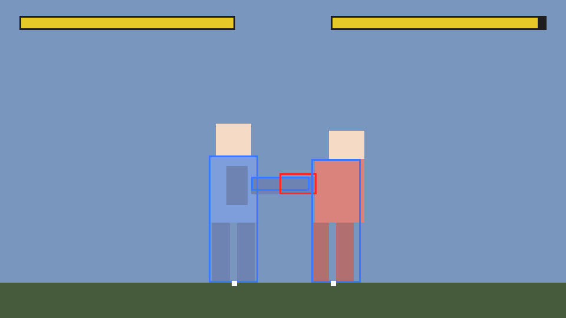

# Hugen

[](https://github.com/sawady/hugen/actions/workflows/ci.yml)

A fighting game engine in Haskell and SDL2, inspired by the classic
[MUGEN](https://en.wikipedia.org/wiki/Mugen_(game_engine)).

- **Ticks at a fixed rate.** The game runs at 60 ticks per second; everything in
  gameplay (animations, hit stun, input windows) is measured in ticks.
- **States and triggers.** A character is always in one numbered state (idle, walk,
  jump, an attack...). Each state has controllers: a trigger (input, time, collisions,
  the opponent's distance...) and an action (change state, set velocity, arm an
  attack...). Triggers are a small typed language embedded in Haskell.
- **A pure, deterministic core.** The simulation is a pure function from the current
  match and this tick's input to the next match. Same inputs, same match, on any
  machine. That makes it testable without a window and ready for replays.

**Status: work in progress.** The core works (states, triggers, commands with an input
buffer, hitboxes and hurtboxes, hit pause, camera) and there is a training room with a
placeholder character drawn with rectangles. There are no sprites, sound, rounds or
menus yet. APIs will change.



## Running it

You need [Stack](https://docs.haskellstack.org/) and the SDL2 development libraries:

```sh
# Debian / Ubuntu
sudo apt-get install libsdl2-dev libsdl2-image-dev
# macOS
brew install sdl2 sdl2_image
```

Then, from the repository root:

```sh
stack build
stack exec hugen                  # training room (needs a display)
stack exec hugen -- --headless    # scripted demo, printed to the terminal
stack test                        # unit tests and QuickCheck properties
```

Without a display (CI, WSL), you can still render a tick of the scripted demo to an
image with SDL's software renderer:

```sh
SDL_VIDEODRIVER=dummy stack exec hugen -- --snapshot demo.bmp 44
```

### Controls (training room)

| Key | Button |
|---|---|
| Arrows | Move, jump, crouch |
| Z, X, C | A, B, C |
| A, S, D | X, Y, Z |
| F1 | Show or hide collision boxes |
| F5 | Reset |
| Escape | Quit |

The test character, Blocky, has a jab (A), a kick (B), a crouching jab, a jump attack,
a forward dash (→ →), a rush (↓ ↘ → + A, also as a cancel from a jab that hits) and an
uppercut (→ ↓ ↘ + B). Player 2 is a dummy that stands still.

## How it fits together

```
src/core/   hugen-core: the pure simulation (depends on base and containers only)
  Hugen/Fixed.hs      fixed-point numbers, no floats in gameplay
  Hugen/Input.hs      pads, facing-relative input
  Hugen/Command.hs    input history, motion commands, command buffer
  Hugen/Expr.hs       the trigger language
  Hugen/Character.hs  states, controllers, attacks, constants
  Hugen/Anim.hs       animations with collision boxes per frame
  Hugen/Box.hs        boxes and overlap
  Hugen/Fighter.hs    a fighter during a match, the trigger evaluator
  Hugen/Match.hs      the tick: step and simulate
  Hugen/Camera.hs     stage and camera
  Hugen/Common.hs     common states (stand, walk, jump, hit...)
  Hugen/Example/      Blocky, the test character, and a scripted demo
src/shell/  hugen: SDL2 window, keyboard, drawing, real-time loop
docs/design.md        architecture and design decisions
```

A taste of the character language:

```haskell
global =
  [ on (cmd "qcf_a" .&& ctrl .&& grounded) (changeState stRush),
    on (cmd "qcf_a" .&& stateNo .== lit stJab .&& moveContact) (changeState stRush),
    on (cmd "a" .&& ctrl .&& stance .== lit Standing) (changeState stJab)
  ]

commands =
  [ command "qcf_a" [Press Down, Press DownFwd, Press Fwd, Buttons [BtnA]],
    command "dp_b" [Press Fwd, Press Down, Press DownFwd, Buttons [BtnB]]
  ]
```

Read [docs/design.md](docs/design.md) for the full design: the order of a tick, command
matching rules, the state model, collisions, the camera and how characters will be
defined.

## Roadmap

Towards a first playable version (0.1):

- [x] Pure core with fixed-rate ticks, states and triggers
- [x] Motion and charge commands with an input buffer
- [x] Hitboxes, hurtboxes, hit pause, hit stun, pushback
- [x] Camera and screen edges
- [x] Training room with a placeholder character; CI
- [ ] Guarding, chip damage, high and low attacks
- [ ] Projectiles (helper entities with their own states)
- [ ] Throws
- [ ] Rounds, timer, KO and win states
- [ ] Sprites from sprite sheets; animation and box data files
- [ ] Two players on one keyboard or with gamepads
- [ ] Sound effects
- [ ] Replays: record, play back, use as regression tests
- [ ] A small original cast

## Contributing

Issues are welcome; see [CONTRIBUTING.md](CONTRIBUTING.md). Changes are listed in
[CHANGELOG.md](CHANGELOG.md).

## License

BSD-3-Clause, see [LICENSE](LICENSE).
